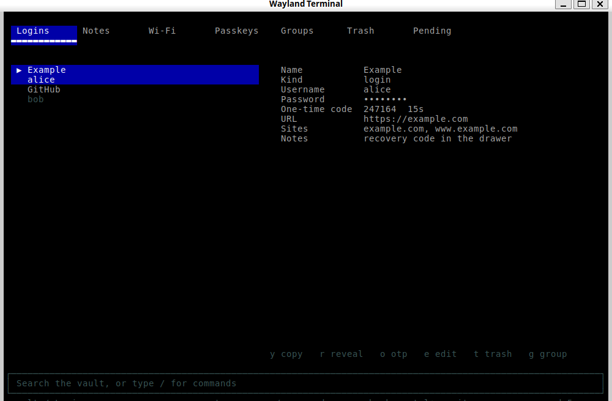

# apw

Apple Passwords on Linux, with a terminal interface and an offline snapshot.



`apw` signs in with your Apple ID, joins the keychain trust with your escrow
passcode, and keeps an encrypted snapshot of logins, notes, Wi-Fi networks,
passkeys, and groups. Queries work offline; edits are queued for the next
sync. Bare `apw` opens the interface, and every subcommand stays scriptable.

## Install

```sh
curl -fsSL https://github.com/win0na/apw/releases/latest/download/install.sh | sh
```

Installs `apw` and `libopentui.so` under `~/.local`; add `~/.local/bin` to
`PATH` if needed. `--prefix DIR` installs elsewhere. Prebuilt releases are
x86_64; aarch64 builds from source, or with Cargo:

```sh
git clone --recurse-submodules https://github.com/win0na/apw
cd apw
cargo install --path . --locked
install -s -D -m 0755 opentui/packages/native/lib/x86_64-linux/libopentui.so \
  "${CARGO_HOME:-$HOME/.cargo}/lib/apw/libopentui.so"
```

Use `aarch64-linux` in place of `x86_64-linux` on ARM. Building needs Rust 1.88
or newer, Zig 0.17.1, `libdbus-1`, and `pkg-config`. On Debian and Ubuntu
install `libdbus-1-dev`; on Arch install `dbus` and `pkgconf`.

Packages are the fallback: Debian, the `apw-cli` AUR package, and the Nix
flake. See [Install](docs/install.md#packages).

## Sign in

```sh
apw login
apw sync
```

The first sign-in asks for the Apple ID password, a two-factor code, and your
escrow passcode. The passcode spends one of about ten attempts and is never
stored.

## Use the interface

Run `apw` with no arguments. Type to filter, `/` opens the command palette, and
`enter` opens the selected item; the full key map is in
[Operate](docs/operate.md).

| Key | Action |
| --- | --- |
| `y` | Copy the password |
| `o` | Copy the current one-time code |
| `r` | Reveal the password for 20 seconds |
| `e` | Edit the item |
| `t` | Move the item to Recently Deleted |

## Use the CLI

```sh
apw list github
apw get github --password-only
apw otp github
apw add login github.com --username you --generate
apw sync --force
```

JSON is the default when stdout is a pipe; a terminal gets a table, and
`--json` forces it. See [Reference](docs/reference.md#json-output).

## Requirements

- Linux x86_64 or aarch64 with glibc, `libdbus-1`, and Secret Service (or
  `APW_PASSPHRASE`).
- An Apple ID with iCloud Passwords, and network access on the first sign-in.

## Docs

[Install](docs/install.md) · [Operate](docs/operate.md) · [Reference](docs/reference.md) ·
[Secrets](docs/secrets.md) · [Troubleshooting](docs/troubleshooting.md) ·
[Design](docs/design.md) · [Changelog](CHANGELOG.md)

## License

GPL-3.0-only.
